# Umstieg von einer CCU3 oder OpenCCU auf openccu-lite - Schritt für Schritt

Diese Anleitung führt durch den Wechsel einer **CCU3** oder eines **OpenCCU** (auf einem Raspberry Pi, einem Charly
oder als VM) auf openccu-lite: vom Backup über das Update bis zu den Programmen und Systemvariablen in **Logic** und den
Programmen, die von außen mit der Zentrale sprechen (RedMatic, ioBroker, Home Assistant, Node-RED). Wo sich CCU3 und
OpenCCU unterscheiden, steht beides im selben Schritt.

Die Referenz zu allen Einzelheiten ist [Wechsel zwischen OpenCCU (oder einer CCU3) und openccu-lite](switching.de.md);
diese Seite ist der Weg in der Reihenfolge, in der Sie ihn gehen. Alle Schritte wurden so durchgeführt, wie sie hier
stehen: mit einer CCU3 (Firmware 3.89.11) und einer OpenCCU-VM (3.89.14) und den Vorabversionen von openccu-lite 2.0.0;
die Bilder stammen aus diesen Durchläufen.

## Was am Ende läuft und was wegfällt

- **Bleibt:** alle angelernten Geräte mit ihren Schlüsseln und direkten Verknüpfungen, die Namen, Räume und Gewerke,
  die Gruppen (zum Beispiel Heizungsgruppen) und die installierten Addons, soweit sie unter openccu-lite laufen.
- **Kommt mit Logic zurück:** Programme und Systemvariablen. openccu-lite selbst hat keine Logikschicht (keine ReGa);
  das Addon **Logic** übernimmt sie aus der Datenbank der alten Zentrale, die dafür nach dem Wechsel auf dem System
  bleibt.
- **Fällt weg:** die WebUI der CCU, HM-Script als eigene Sprache der Zentrale, CUxD und die XML-API. Programme mit
  Scripts übernimmt Logic als inaktive Programme, die Sie selbst nachbauen.

**Wie lange es dauert:** Im Labor brauchte das Update auf der CCU3 etwa vier Minuten zum Hochladen und danach
23 Minuten bis zum ersten Start von openccu-lite, auf der OpenCCU-VM wenige Sekunden zum Hochladen und 90 Sekunden bis
zum ersten Start. Logic installieren und die Programme übernehmen dauert jeweils wenige Minuten, jede angebundene
Software ebenso.

## 1. Vorbereiten (am alten System)

### 1.1 Welches System Sie haben und welches Paket Sie brauchen

In der WebUI: **Einstellungen → Systemsteuerung → Zentralen-Wartung**.

**CCU3:** Die Seite heißt *CCU-Wartung* und zeigt die Firmware von eQ-3 (hier 3.89.11). Eine CCU3 braucht das Paket
`openccu-lite-aarch64-rpi3-<Version>-ccu3.tgz`.

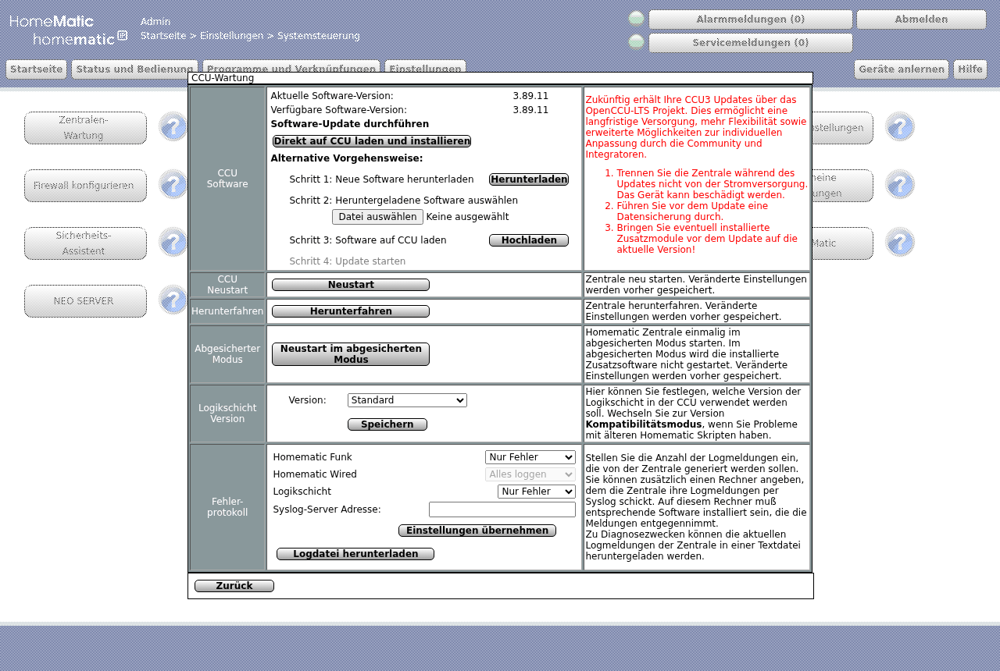

**OpenCCU:** Die Seite heißt *OpenCCU-Wartung*; hinter der Version steht in Klammern, worauf OpenCCU läuft, zum
Beispiel `(ova)` für die VM. Die VM braucht `openccu-lite-x86_64-ova-<Version>.zip`, ein Raspberry Pi
`openccu-lite-aarch64-rpi3-<Version>.zip` oder `openccu-lite-aarch64-rpi4-<Version>.zip`. Welche Datei zu welchem
System gehört, auch für Sonderfälle, steht in der Tabelle
[Welches Paket für welches System](switching.de.md#welches-paket-für-welches-system).

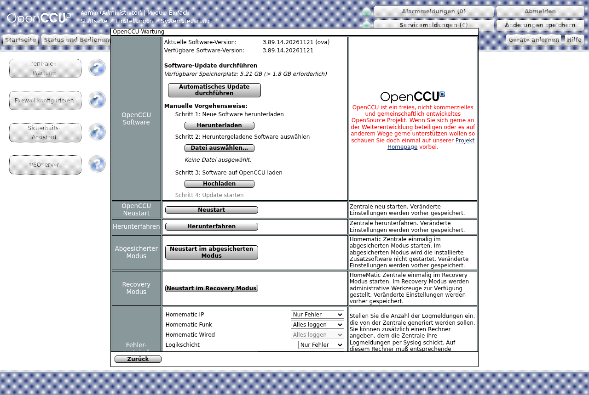

Laden Sie das Paket und die gleichnamige Datei mit der Endung `.sha256` von der
[Release-Seite](https://github.com/openccu-lite/openccu-lite/releases) und prüfen Sie die Prüfsumme:

- Linux: `sha256sum -c <Paket>.sha256` im Ordner der beiden Dateien; die Ausgabe endet auf `OK`.
- macOS: `shasum -a 256 -c <Paket>.sha256`, ebenso.
- Windows (Eingabeaufforderung): `certutil -hashfile <Paket> SHA256` und die ausgegebene Prüfsumme mit der ersten
  Zeichenkette in der `.sha256`-Datei vergleichen.

Für openccu-lite 2.0.0 heißt das Paket einer CCU3 zum Beispiel `openccu-lite-aarch64-rpi3-2.0.0-ccu3.tgz`.

### 1.2 Was heute mit der Zentrale spricht

Schreiben Sie auf, welche Addons installiert sind (**Einstellungen → Systemsteuerung → Zusatzsoftware**) und welche
Programme von außen mit der Zentrale sprechen: ioBroker, Home Assistant, ein Node-RED auf einem anderen Rechner, eine
App. Für jedes davon gibt es unten in [Angebundene Software](#6-angebundene-software) einen eigenen Abschnitt.

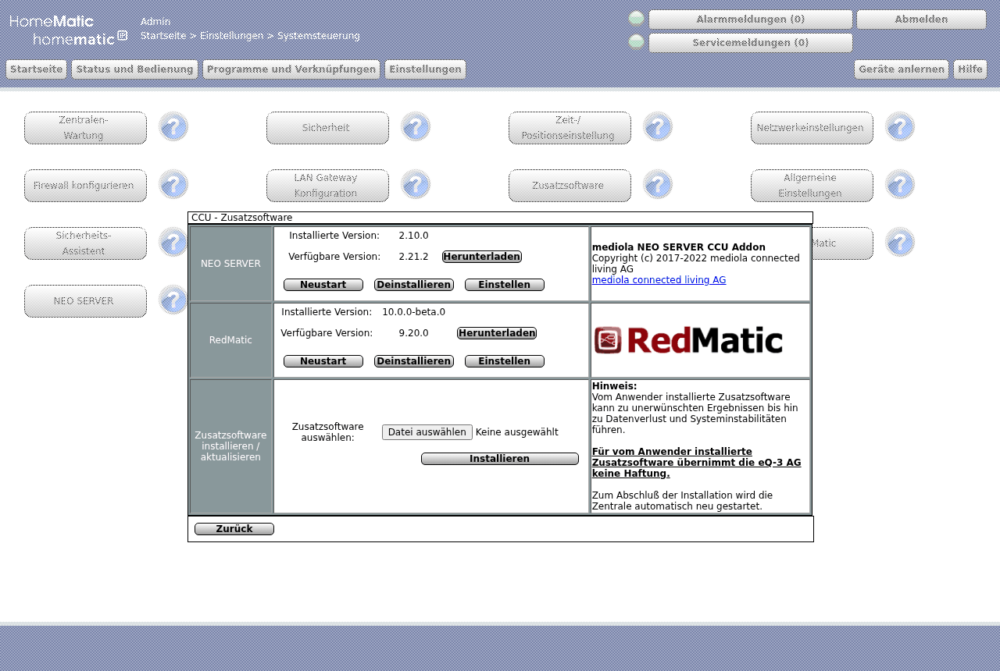

**Was mit den Addons einer CCU3 passiert:**

- **NEO SERVER** (mediola), auf jeder CCU3 vorinstalliert, braucht die Logikschicht der CCU. openccu-lite **entfernt
  ihn beim ersten Start**; er steht danach nirgends mehr.
- **RedMatic** in der Fassung für die CCU3 läuft auf openccu-lite nicht (openccu-lite ist ein 64-Bit-System). Es
  wird beim ersten Start **deaktiviert, nicht gelöscht**; wie es wieder läuft, steht unter
  [RedMatic auf dem System](#redmatic-auf-dem-system).

Auf der OpenCCU im Labor war keine Zusatzsoftware installiert. Was mit anderen Addons geschieht, steht in
[Was sich beim ersten Start ändert](switching.de.md#was-sich-beim-ersten-start-ändert).

### 1.3 Programme und Systemvariablen ansehen

Logic übernimmt Ihre Programme und Systemvariablen später aus der Datenbank der Zentrale. Sehen Sie sich jetzt an,
was Sie haben, damit Sie es nachher vergleichen können: **Programme und Verknüpfungen → Programme** und
**Einstellungen → Systemvariable**.

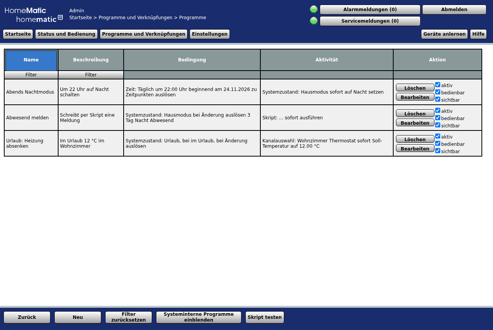

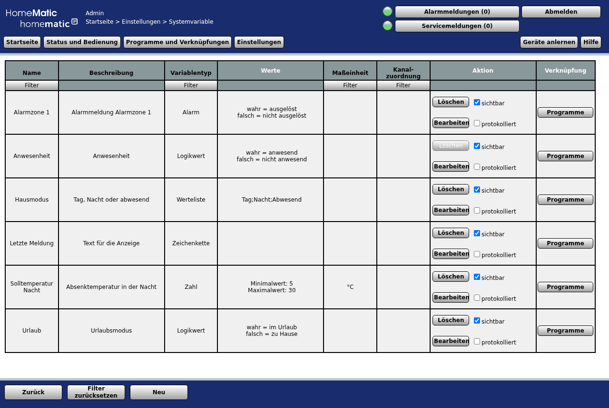

Ein Programm, das ein Script ausführt (hier *Abwesend melden*), kommt als inaktives Programm in Logic an; notieren Sie
sich, was das Script tut.

### 1.4 Das Backup

**Einstellungen → Systemsteuerung → Sicherheit**, im Abschnitt *Backup-Verwaltung* auf **Backup erstellen** klicken.

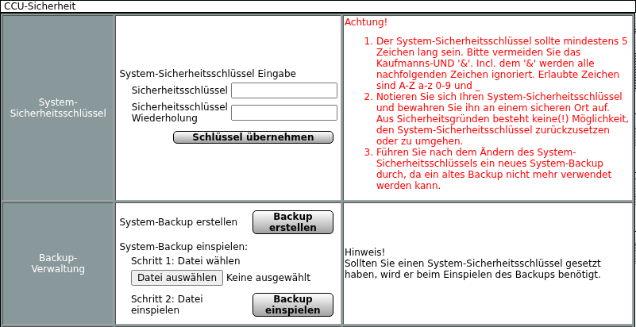

Die Zentrale meldet *Das System-Backup wird jetzt erstellt. Dieser Vorgang kann einige Minuten dauern.*; der Browser
lädt danach eine Datei mit der Endung `.sbk` herunter (bei einer CCU3 zum Beispiel `ccu3-webui-<Datum>.sbk`). Den
Hinweis mit **OK** schließen. Bewahren Sie die Datei auf: Sie ist der Weg zurück.

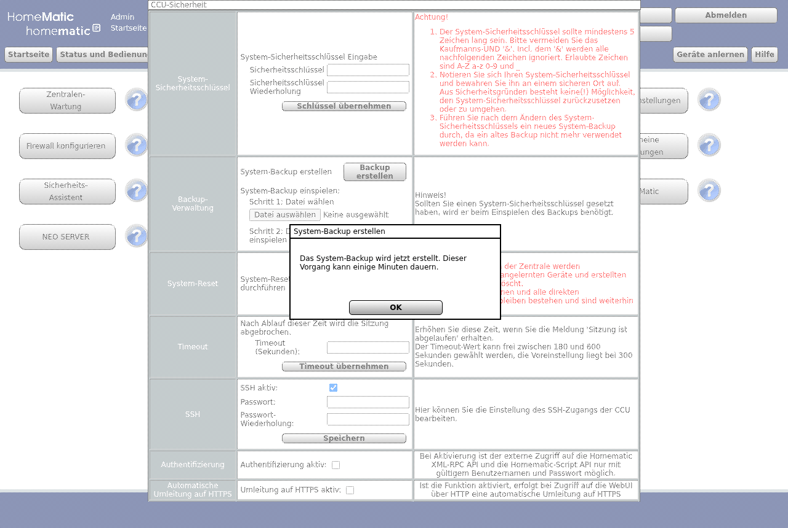

Wenn ein **System-Sicherheitsschlüssel** gesetzt ist, suchen Sie ihn jetzt heraus: Wer das Backup einspielt, braucht
ihn (so steht es auch neben dem Knopf).

### 1.5 Eine Kopie des ganzen Systems

Das Backup ist der langsame Weg zurück, eine Kopie des ganzen Systems der schnelle:

- **OpenCCU als VM:** einen Snapshot der VM anlegen (oder sie klonen).
- **Raspberry Pi oder Charly:** das System herunterfahren und die SD-Karte in eine Image-Datei lesen.
- **CCU3:** Die SD-Karte steckt im Gehäuse. Wer es nicht öffnen möchte, hat mit dem Backup aus 1.4 trotzdem einen
  Weg zurück; er dauert nur länger.

Wie das mit welchem Werkzeug geht, steht in
[Zuerst eine Kopie des ganzen Systems](switching.de.md#zuerst-eine-kopie-des-ganzen-systems).

### 1.6 Freier Platz

**OpenCCU** zeigt den freien Platz auf der Wartungsseite (*Verfügbarer Speicherplatz*, siehe das Bild unter 1.1).
openccu-lite braucht dort mindestens 2,8 GB; die Einzelheiten stehen in
[Der Platz, den das Update braucht](switching.de.md#der-platz-den-das-update-braucht).

**CCU3:** Die Wartungsseite der CCU3 zeigt den freien Platz nicht. Auf der CCU3 im Labor (Firmware 3.89.11, 16-GB-Karte)
waren auf dem Datenbereich nur 1,7 GB frei; das Update hat den Datenbereich selbst bis zum Ende der Karte vergrößert
und ist durchgelaufen. Platz schaffen müssen Sie auf einer CCU3 also normalerweise nicht; das gilt, solange hinter
dem Datenbereich noch Platz auf der Karte ist.

### 1.7 Die angebundene Software vorbereiten

Die angebundenen Programme selbst müssen Sie vor dem Wechsel nicht anfassen; ihre Verbindung stellen Sie danach um
(Abschnitt 6). Eine Sicherung mit den eigenen Mitteln von ioBroker oder Home Assistant ist trotzdem eine gute Idee, denn
beim Umstellen ändern sich dort Einstellungen und Objekte.

Wer ioBroker mit hm-rega nutzt, hat meist die **Remote Homematic-Script API** in der Firewall der Zentrale
freigegeben (**Einstellungen → Systemsteuerung → Firewall konfigurieren**). Diese Schnittstelle gibt es unter
openccu-lite nicht mehr; die Programme sprechen danach über andere Wege mit dem System (siehe unten).

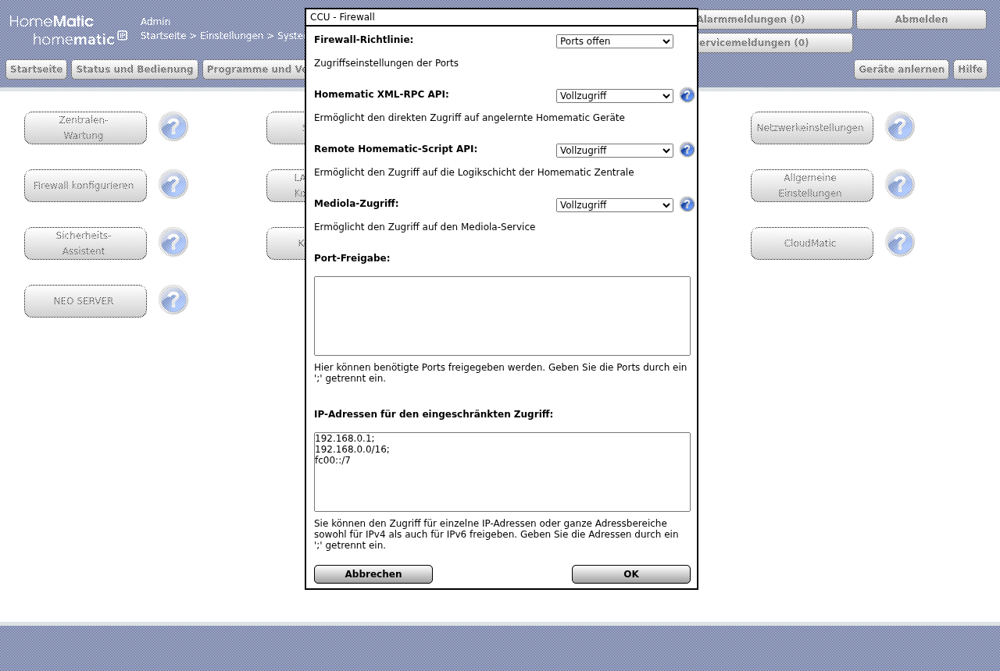

## 2. Das Update einspielen

Die Bilder zeigen den Weg auf der CCU3; auf OpenCCU sind die Schritte dieselben, die Unterschiede stehen jeweils dabei.

1. **Einstellungen → Systemsteuerung → Zentralen-Wartung**, unter *Schritt 2* auf **Datei auswählen** klicken und das
   Paket wählen.

   

2. Unter *Schritt 3* auf **Hochladen** klicken. Die Zentrale meldet *Das Firmware-Update wird auf die CCU übertragen.*
   Auf der CCU3 im Labor dauerte das mit allen Prüfungen etwa vier Minuten, auf der OpenCCU-VM vier Sekunden.

   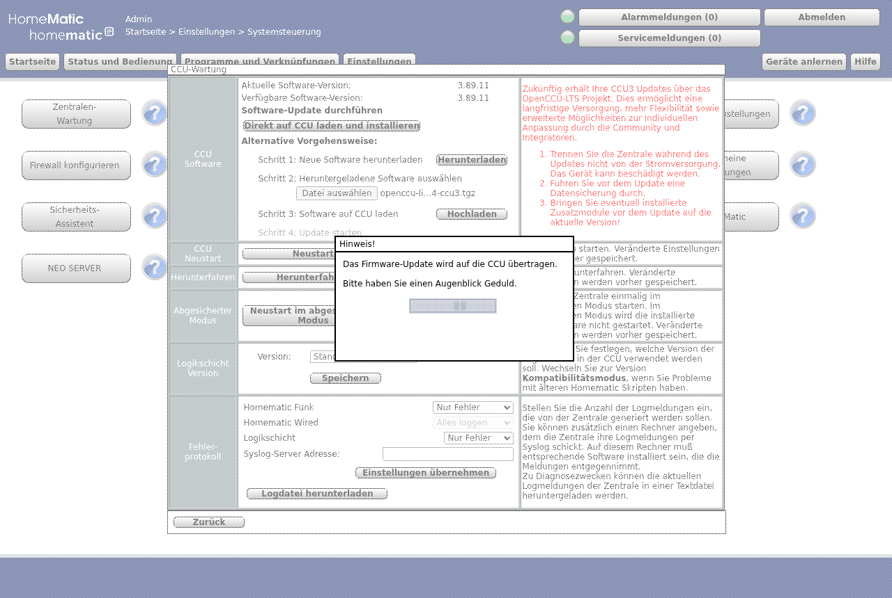

3. Die Zentrale fragt, ob sie vor dem Update ein **System-Backup** erstellen soll. Lassen Sie den Haken gesetzt und
   klicken Sie **Weiter**. **OpenCCU** lädt das Backup gleich hier herunter (im Labor nach einigen Sekunden), die CCU3
   erst nach *Update starten* (Schritt 5).

   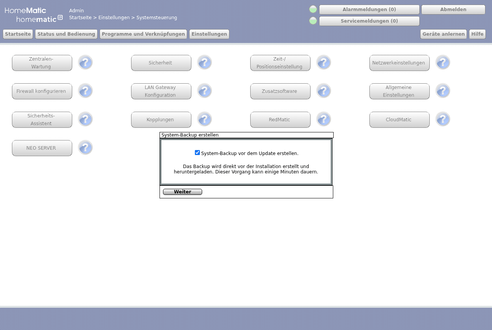

4. Der **Endbenutzer-Lizenzvertrag** beginnt mit dem Abschnitt von openccu-lite (*Sie installieren openccu-lite.*).
   Den Haken bei *Ich stimme den Bedingungen des Lizenzvertrags zu* setzen und **Installieren** klicken.

   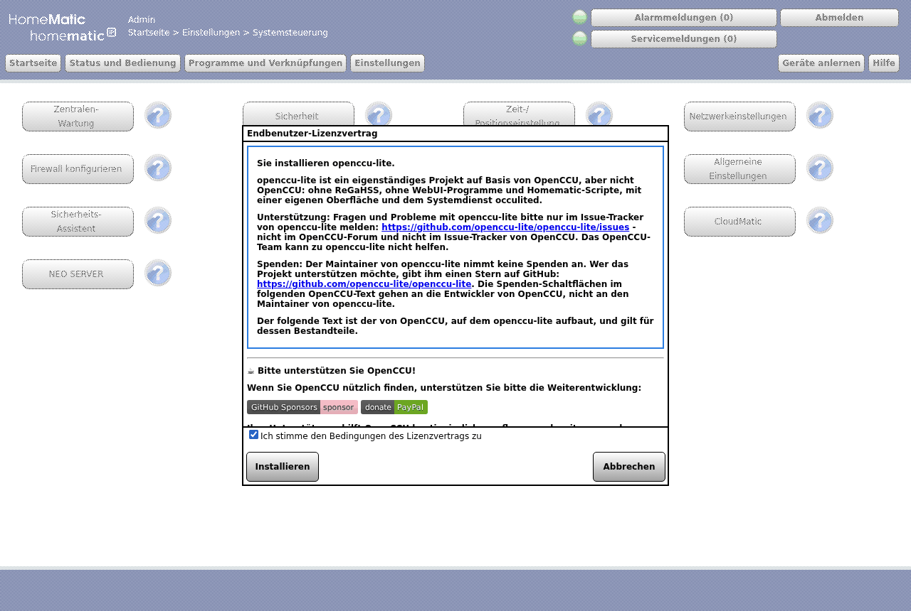

5. *Die einzuspielende Softwaredatei befindet sich jetzt auf der CCU.* Auf **Update starten** klicken. Wenige Sekunden
   später lädt der Browser auf einer CCU3 das Backup aus Schritt 3 herunter (`ccu3-webui-<Datum>.sbk`); bewahren Sie
   es zusammen mit dem aus 1.4 auf.

   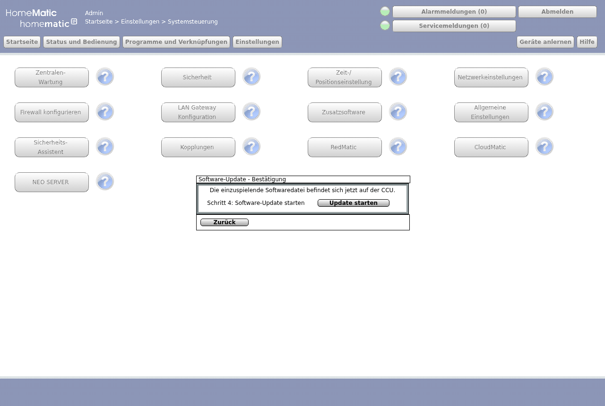

6. Die Zentrale meldet *Das Software-Update wird jetzt durchgeführt.* Den Hinweis zum Browser-Cache können Sie
   übergehen: openccu-lite hat eine eigene Oberfläche.

   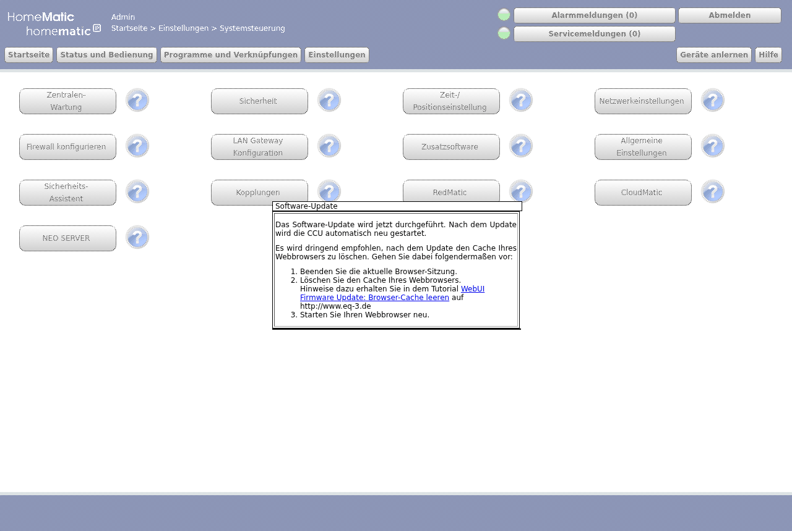

**Jetzt warten und das System nicht ausschalten.** Eine CCU3 startet zweimal neu, vergrößert dabei ihre
Systempartition und verschiebt den Datenbereich. Im Labor war openccu-lite **23 Minuten** nach *Update starten* da;
auf einer langsameren oder größeren Karte kann es bis zu 40 Minuten dauern. Unter der Adresse des Systems zeigt der
Browser währenddessen meist die Ausgabe des Updates (*Displaying running firmware update output*); es kann aber auch
eine Weile gar nichts zu sehen sein, während die Status-LED schnell magenta blinkt (siehe
[Ein dunkles Update](switching.de.md#ein-dunkles-update-auf-einem-raspberry-pi-3-oder-charly)). Das Protokoll des
Updates steht nach dem ersten Start im Log von openccu-lite.

**OpenCCU** meldet *OpenCCU wird nun neu gestartet und im Anschluss das Software-Update durchgeführt.* Auf der VM im
Labor war openccu-lite 90 Sekunden nach *Update starten* da.

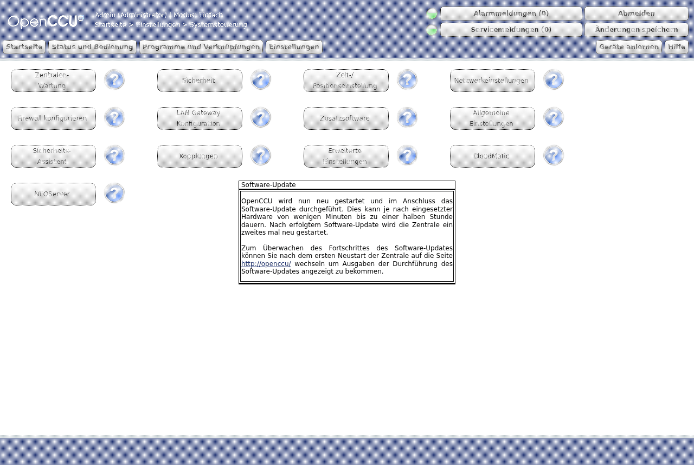

## 3. Der erste Start von openccu-lite

Laden Sie die Adresse des Systems neu (`http://<Adresse>/`, dieselbe wie vorher). openccu-lite fragt zuerst nach dem
**ersten Administrator**: Benutzername und Passwort wählen, **Administrator anlegen**. Das ist ein neues Konto; das
Passwort der alten WebUI gilt hier nicht.

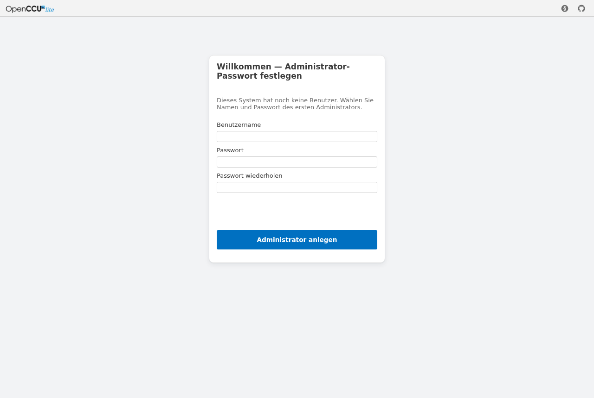

Danach kommt die Seite **Willkommen**. Sie sagt, was beim ersten Start übernommen wurde (*Namen, Räume und Gewerke
wurden beim ersten Start aus der ReGa-Datenbank gelesen*), und dass die Programme und Systemvariablen in der Datenbank
bleiben, bis Logic sie übernimmt. Der Name des Systems bleibt der der CCU.

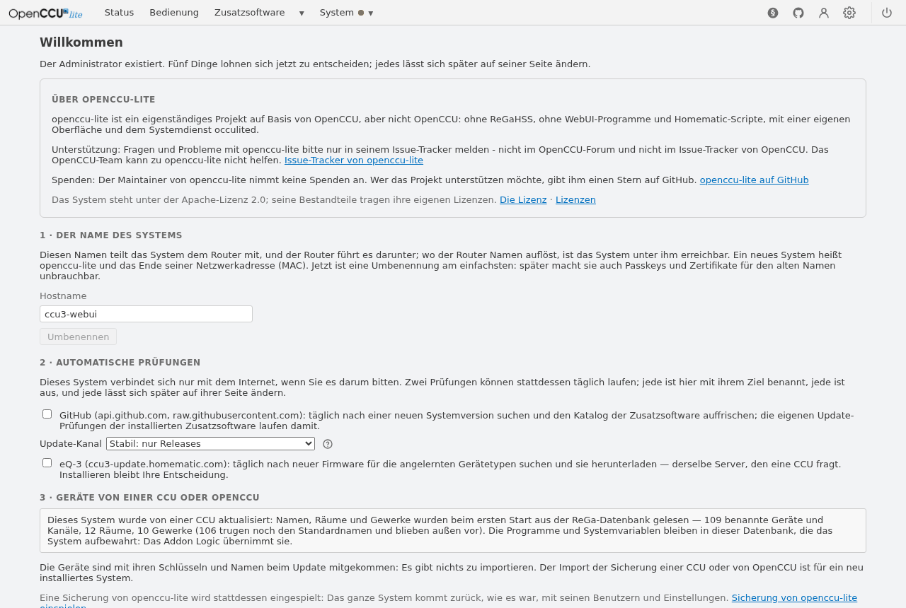

Unten auf der Seite wählen Sie, ob **BidCos-RF** an bleibt (wer noch ältere Homematic-Geräte hat, lässt es an), und
klicken auf **Fertig**. Logic installieren Sie im nächsten Schritt. (Auf einem System ohne Funkmodul, etwa einer
OpenCCU-VM, fehlt die Frage nach BidCos-RF.)

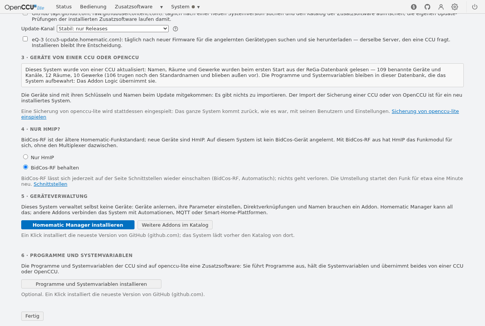

Die Seite **Status** zeigt danach den Zustand des Systems. Auf einer umgestellten CCU3 stehen dort Hinweise, die zu
diesem Zeitpunkt normal sind:

- *Inkompatibles Addon deaktiviert: RedMatic.* - siehe [RedMatic auf dem System](#redmatic-auf-dem-system).
- *Klassisches RPC ist ohne Anmeldung eingeschaltet* - Programme, die die Zentrale über ihre alten Ports erreichen,
  arbeiten damit vorerst weiter; abgesichert wird das unter [Nacharbeiten](#5-nacharbeiten), wenn alle Programme
  umgestellt sind.
- *Die Sicherung ist nicht verschlüsselt* und *Das Journal liegt nur im RAM* - Einstellungen, die Sie später setzen
  können.

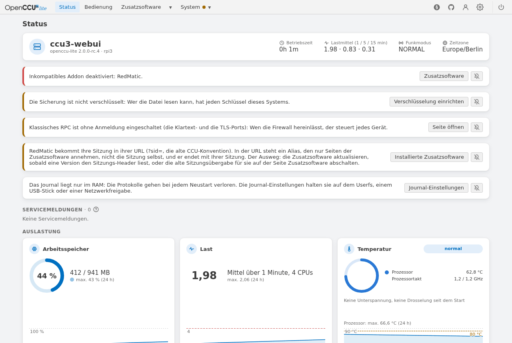

**OpenCCU ohne Funkmodul:** Auf der VM im Labor lief danach nur die Schnittstelle *VirtualDevices* mit den
Heizungsgruppen; HmIP-RF stellt der erste Start auf einem System ohne Funkmodul selbst ab. Hinweise zu Addons gab es dort
keine, denn es war keines installiert.

Unter **Bedienung** finden Sie Ihre Räume und Gewerke wieder, mit den Kanälen darin:

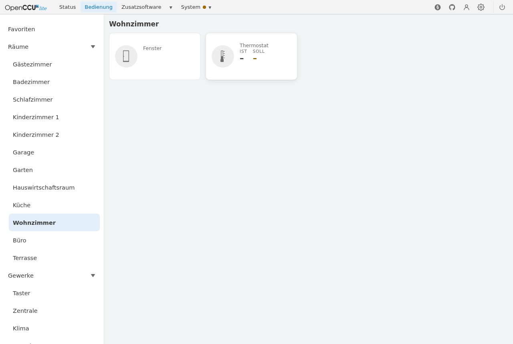

## 4. Logic installieren und Programme und Systemvariablen übernehmen

1. **Zusatzsoftware → Addons verwalten.** Beim ersten Besuch zeigt die Seite nur eine mitgelieferte Liste; ein Klick
   auf **Katalog jetzt laden** holt den Katalog von GitHub. Ins Filterfeld *Logic* eingeben.

   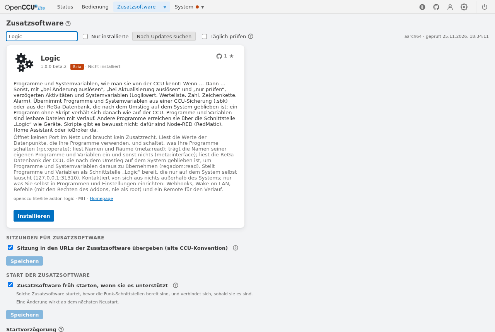

2. Auf der Karte **Logic** auf **Installieren** klicken und die Frage bestätigen. Logic läuft als eigener Benutzer
   und braucht kein Zusatzrecht; als Vorabversion steht ein Hinweis dabei.

   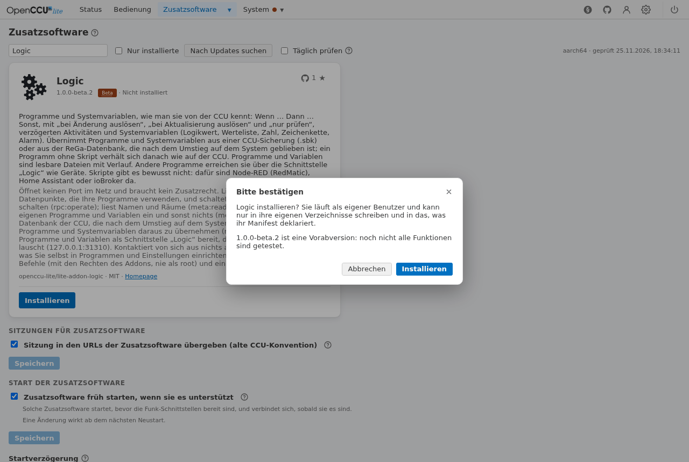

   Oben auf der Seite läuft ein Fortschrittsbalken; nach wenigen Sekunden steht dort *logic: fertig* und auf der Karte
   *Läuft*. Ein Neustart ist nicht nötig.

   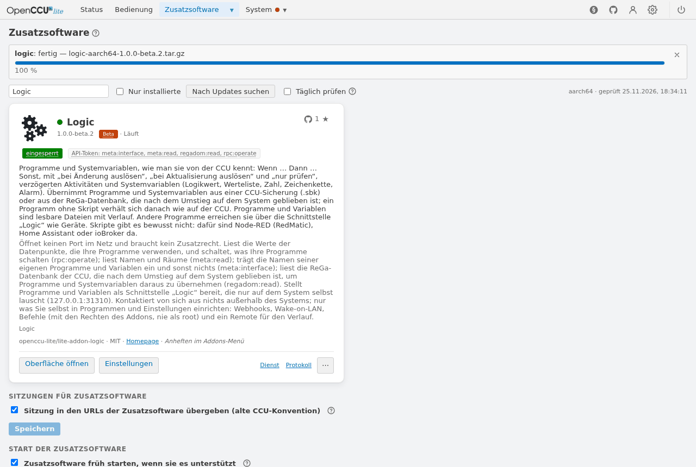

3. Auf der Karte **Oberfläche öffnen**, dann den Reiter **Import**. Unter *Aus der Datenbank, die auf dem System
   geblieben ist* auf **Gebliebene Datenbank lesen** klicken.

   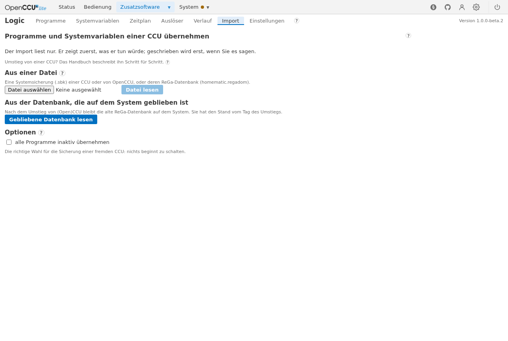

4. Logic zeigt zuerst einen **Probelauf** (*noch ist nichts geschrieben*): welche Programme aktiv und welche inaktiv
   übernommen würden, die Systemvariablen mit ihren Werten und die Geräte, die in Programmen vorkommen. Ein Programm mit
   Script kommt inaktiv an; sein Script bleibt als Text erhalten. Die Systemvariablen der CCU wie *Anwesenheit* und
   *Alarmzone 1* kommen mit; Werte wie *Alarmmeldungen* und *Servicemeldungen* pflegt das System selbst.

   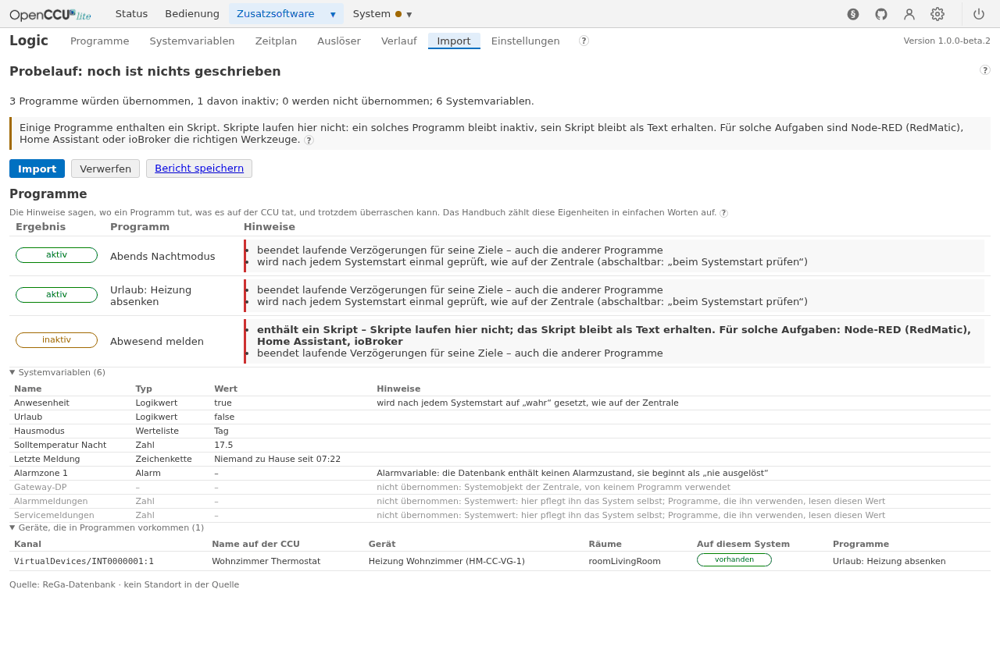

5. Stimmt der Bericht, auf **Import** klicken. Logic übernimmt alles sofort und meldet *Übernommen*.

   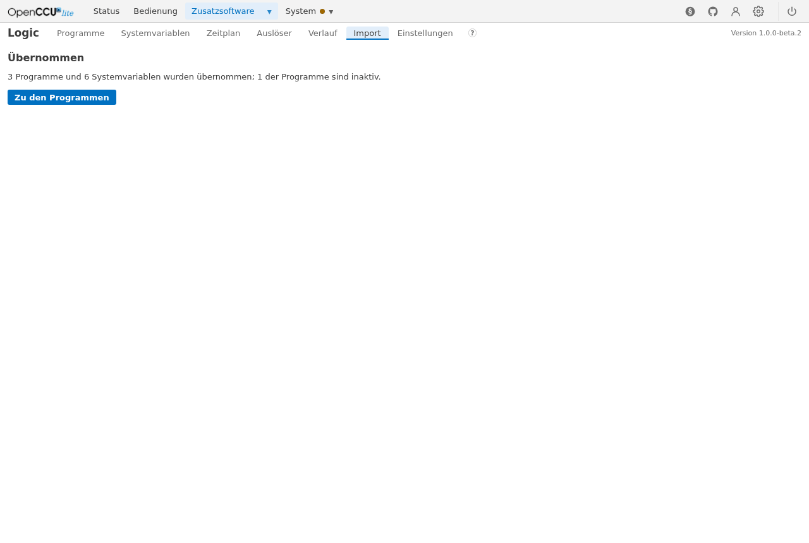

**Der kürzere Weg über die Willkommensseite:** Auf der OpenCCU-VM wurde Logic direkt auf der Seite **Willkommen**
installiert: Punkt *Programme und Systemvariablen* → **Programme und Systemvariablen installieren**. Das System lädt
den Katalog selbst und installiert Logic ohne weitere Frage; danach stehen dort **Programme und Systemvariablen öffnen**
und **Programme und Systemvariablen übernehmen**.

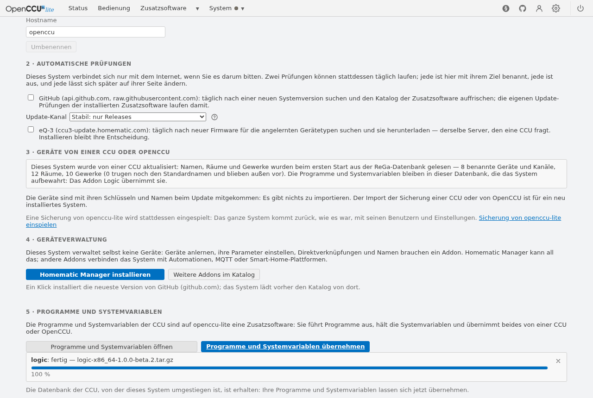

*Programme und Systemvariablen übernehmen* öffnet Logic in einem neuen Tab. Im Labor öffnete es die Seite *Programme*
statt *Import*; dann dort auf **Import** klicken und weiter wie oben ab Schritt 3.

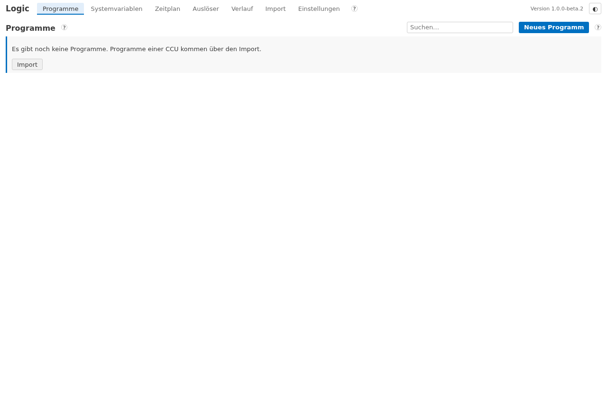

**Prüfen:** Unter **Programme** stehen die Programme wie auf der CCU, mit ihrem Auslöser und der nächsten Zeit eines
Zeitmoduls; unter **Systemvariablen** die Variablen mit ihren Werten.

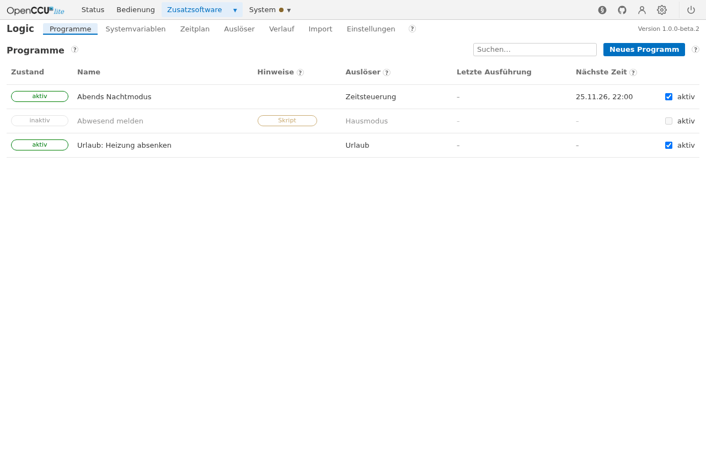

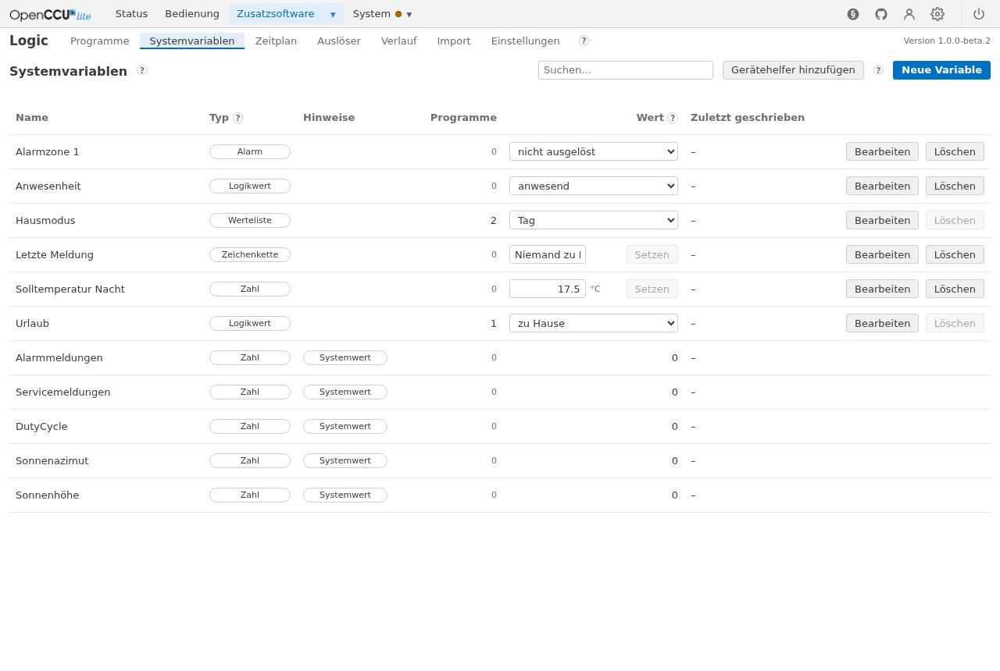

Zum Ausprobieren eine Variable ändern, die ein Programm auslöst: Im Labor wurde *Urlaub* auf *im Urlaub* gesetzt;
unter **Verlauf** steht danach, dass *Urlaub: Heizung absenken* lief und die Solltemperatur des Wohnzimmers auf 12 °C
gesetzt hat, gesendet und bestätigt.

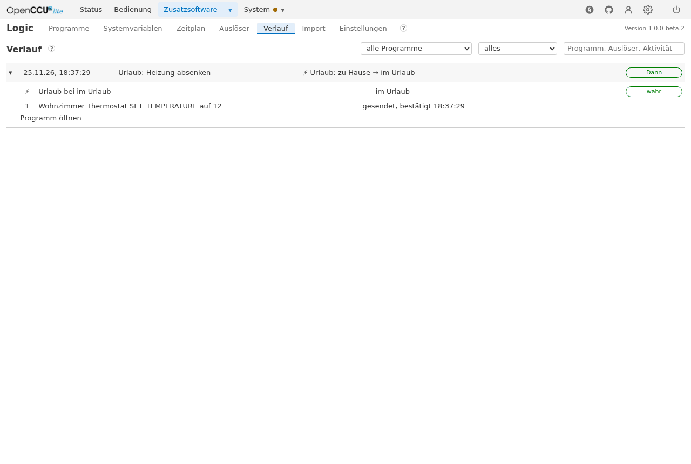

**Den Standort eintragen.** Die Datenbank der CCU enthält keinen Standort; ohne ihn rechnet Logic keinen
Sonnenaufgang und Sonnenuntergang. Unter **Einstellungen → Standort** Breiten- und Längengrad eintragen und speichern.

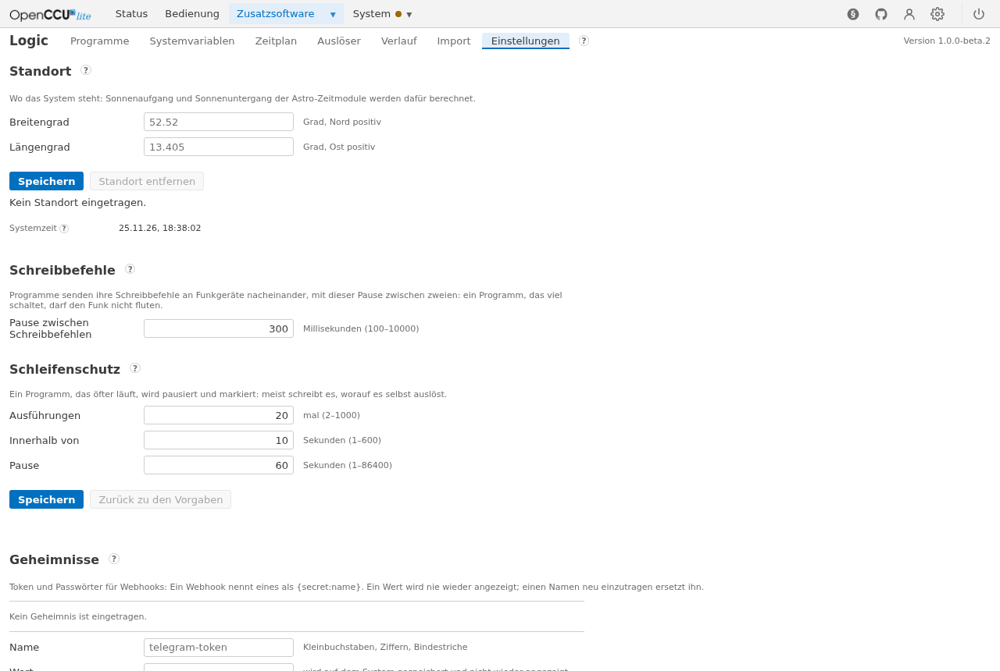

Das Programm mit Script bauen Sie selbst nach: als normales Logic-Programm, wenn es nur Werte setzt, oder in Node-RED,
Home Assistant oder ioBroker. Alles Weitere steht im Handbuch von Logic (das *?* auf jeder Logic-Seite führt dorthin).

## 5. Nacharbeiten

Erledigen Sie diese Punkte, wenn Logic und alle angebundenen Programme (Abschnitt 6) laufen.

### Klassisches RPC abschalten

Nach dem Wechsel sind die alten RPC-Ports der CCU (2001, 2010, 9292 und ihre TLS-Varianten) ohne Anmeldung offen, damit
Programme, die noch nicht umgestellt sind, weiterarbeiten. Die Status-Seite warnt davor. Sobald alles umgestellt ist:

1. **System → Fernzugriff.** Unter *Angemeldete Clients* steht für jede Schnittstelle, wer die alten Ports noch
   benutzt. Im Labor stand nach dem Umstellen von ioBroker, Home Assistant und RedMatic überall *0 Abonnenten*.

   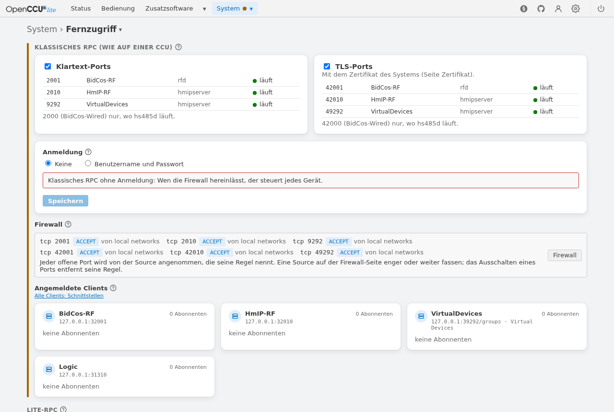

2. Die Haken bei **Klartext-Ports** und **TLS-Ports** entfernen und **Speichern** klicken. Das System startet seinen
   Webserver neu (*die Seite antwortet dabei kurz nicht*); danach steht dort *Kein klassischer Port ist eingeschaltet,
   die Firewall muss also nichts hereinlassen.*

   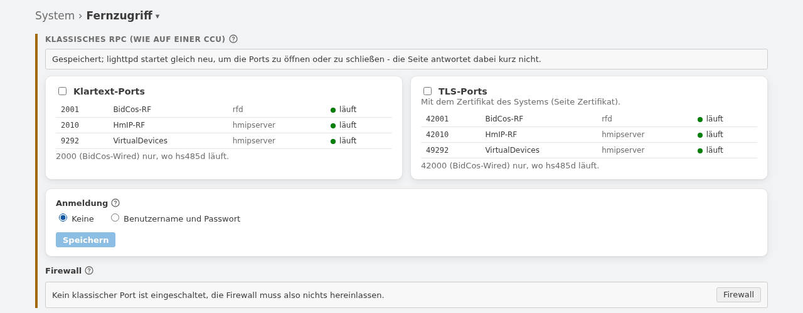

Die Warnung auf der Status-Seite ist danach weg; ioBroker, Home Assistant und RedMatic blieben im Labor verbunden.
Braucht ein Programm die alten Ports doch noch, wählen Sie statt des Abschaltens unter *Anmeldung* **Benutzername und
Passwort**.

### Eine Sicherung von openccu-lite

**System → Sicherung → Sicherung herunterladen.** Der Browser lädt eine `.sbk`-Datei herunter (im Labor
`ccu3-webui-3.89.14-<Datum>-<Uhrzeit>.sbk`). Das ist jetzt Ihr Weg zurück zu diesem Stand; das Backup der alten Zentrale
aus Schritt 1.4 bleibt der Weg zurück zur CCU3 oder zu OpenCCU. Die Status-Seite empfiehlt außerdem, die Sicherung zu
verschlüsseln (**Verschlüsselung einrichten**).

### Die Datenbank der alten Zentrale entfernen

Die Datenbank der CCU, aus der Logic die Programme und Systemvariablen übernommen hat, bleibt auf dem System, bis Sie sie
entfernen. Sie steht unter **System → Sicherung** im Abschnitt *ReGa-Datenbank der CCU*.

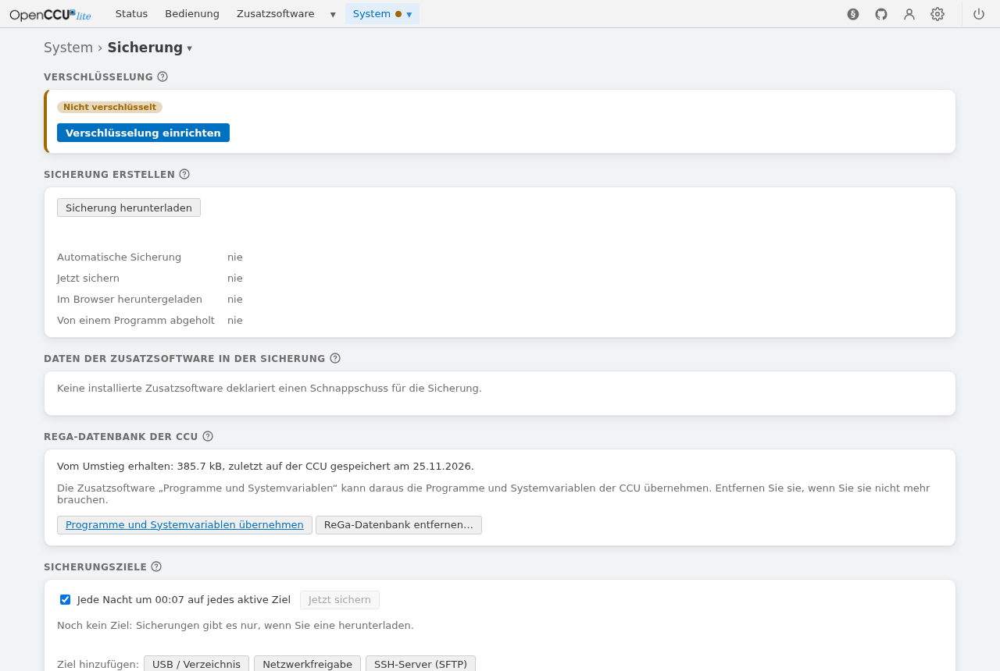

Wenn der Import in Logic stimmt und Sie eine Sicherung von openccu-lite haben: **ReGa-Datenbank entfernen…** und die
Frage mit **Entfernen** bestätigen. Danach meldet die Seite *Die ReGa-Datenbank wurde entfernt*.

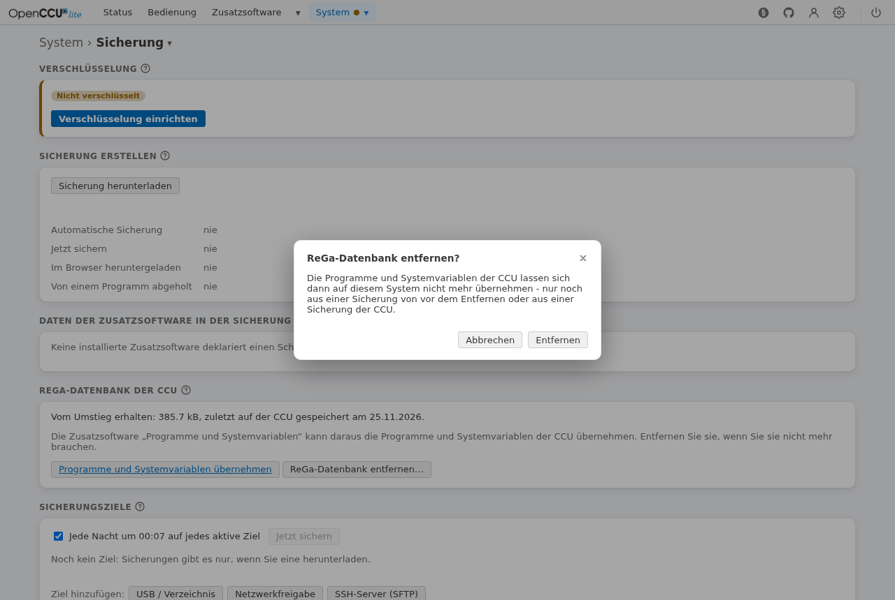

### SSH

SSH steht unter **System → Fernzugriff** im Abschnitt *SSH*. Auf der umgestellten CCU3 im Labor war SSH danach an
(*aktiviert und läuft*), mit dem root-Passwort der CCU. Wer SSH nicht braucht, schaltet es dort mit **SSH
deaktivieren** ab; wer es braucht, kann darunter einen Schlüssel hinterlegen.

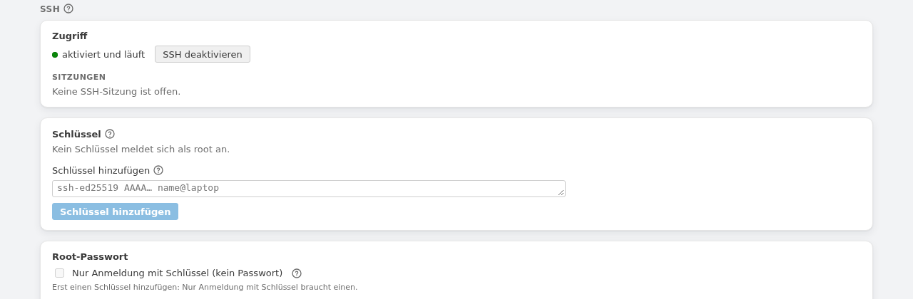

## 6. Angebundene Software

### RedMatic auf dem System

RedMatic für die CCU3 ist ein 32-Bit-Paket; openccu-lite auf dem Raspberry Pi 3 ist ein 64-Bit-System. Darum
deaktiviert der erste Start RedMatic (*Inkompatibles Addon deaktiviert: RedMatic.* auf der Status-Seite, *deaktiviert,
inkompatibel* auf der Karte). Die Flows bleiben erhalten. Läuft RedMatic nach dem Wechsel weiter (weil es schon das
passende Paket war), beginnen Sie bei Schritt 3.

1. **Zusatzsoftware → Addons verwalten**, auf der Karte **RedMatic** das Menü **⋯** öffnen und **Aus dem Katalog neu
   installieren** wählen, dann bestätigen.

   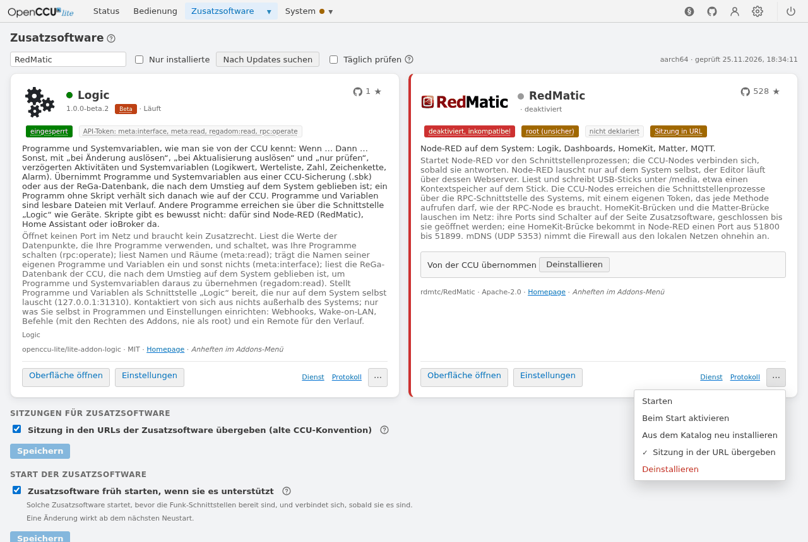

2. Das System lädt die aktuelle Fassung für openccu-lite und installiert sie; im Labor dauerte das knapp zwei Minuten.
   Steht RedMatic danach auf *Gestoppt* (so war es im Labor), im Menü **⋯** auf **Starten** klicken.

   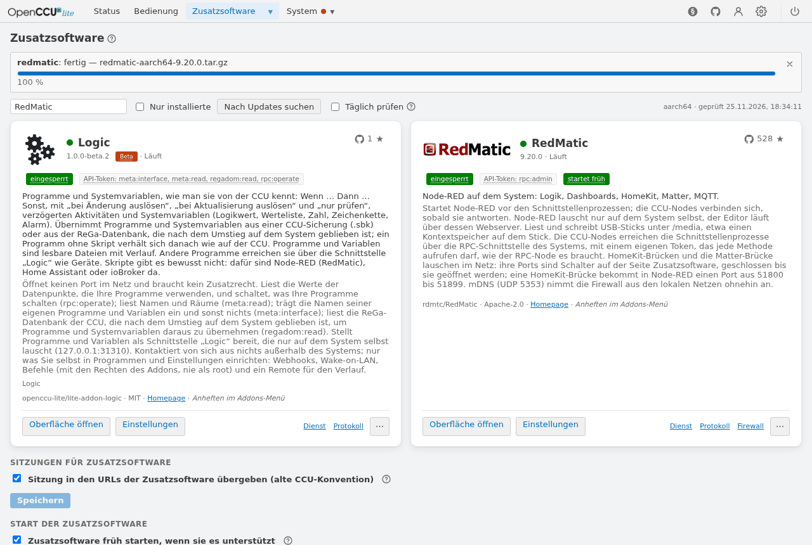

3. **Für Systemvariablen und Programme braucht es RedMatic 10.0.0 oder neuer** (darin node-red-contrib-ccu 4.14.1). Zeigt
   die Karte eine ältere Version (im Labor kam beim Neuinstallieren zuerst 9.20.0), auf **Nach Updates suchen** und
   dann auf der Karte auf **Auf 10.0.0 aktualisieren** klicken und bestätigen. Flows und Einstellungen bleiben, und
   RedMatic läuft danach von selbst weiter.

   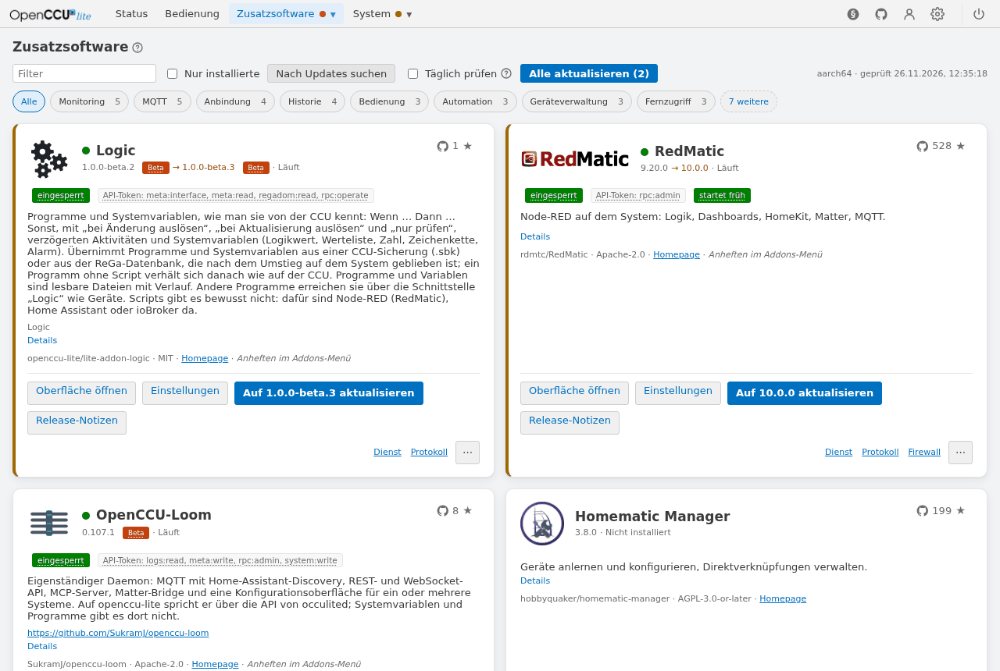

4. Die Flows sind unverändert da. Die Verbindung zur Zentrale stellt RedMatic beim ersten Start selbst auf die
   Schnittstelle von openccu-lite um; Geräte lesen und schalten funktioniert wie vorher. Mit einer Version vor 10.0.0
   bleiben die Knoten *sysvar* und *program* auf *disconnected*.

**Systemvariablen und Programme.** Die Knoten *sysvar* und *program* finden eine Variable oder ein Programm wie auf der
CCU an seinem Namen, jetzt in Logic. Ein Flow, der für die CCU geschrieben wurde, arbeitet also weiter, sobald Logic die
Programme und Systemvariablen übernommen hat (Abschnitt 4). Im Labor las der Knoten *Urlaub* den Wert aus Logic, ein
Inject mit `true` an einen zweiten Knoten *Urlaub* setzte die Variable, und Logic führte daraufhin *Urlaub: Heizung
absenken* aus. Ein Knoten *program* schaltet ein Programm mit `true` oder `false` aktiv oder inaktiv; jede andere
Nachricht startet es, wie *Ausführen* auf der CCU (hier das Inject *Nachtmodus starten*). Eine Werteliste wie
*Hausmodus* liefert wie auf der CCU die Nummer des Eintrags (`1` für *Nacht*).

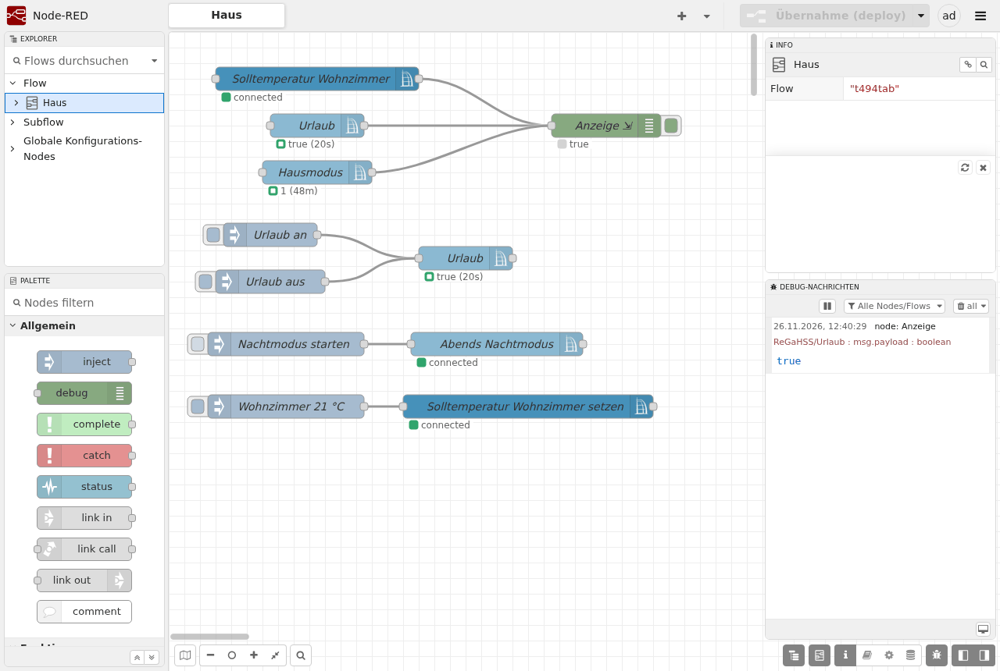

Im **Verlauf** von Logic steht ein Programm, das Node-RED gestartet hat, mit dem Auslöser *von außen*:

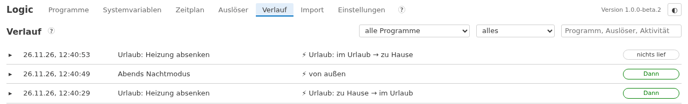

Wenn Logic nicht installiert ist, zeigen die Knoten *Logic addon not installed*. **Was nicht mehr geht:** HM-Script.
Der Knoten *script* bleibt im Flow und beantwortet jede Nachricht mit einem Fehler; der Knoten *poll* hat nichts mehr
abzufragen, denn die Werte aus Logic kommen bei jeder Änderung von selbst. Was ein Script tat, bauen Sie als Logic-Programm
oder als Flow nach.

### ioBroker

Ausgangslage im Labor: ein ioBroker mit **hm-rpc 4.1.2** (zwei Instanzen: `hm-rpc.0` für HmIP-RF, `hm-rpc.1` für die
virtuellen Geräte) und **hm-rega 6.1.0**. Nach dem Wechsel arbeiteten die hm-rpc-Instanzen über das klassische RPC
weiter, hm-rega meldete *ReGaHSS down*. Die Einzelheiten zu Räumen, Namen und bekannten Grenzen stehen in
[ioBroker: von einer CCU3 oder OpenCCU zu openccu-lite](iobroker.de.md).

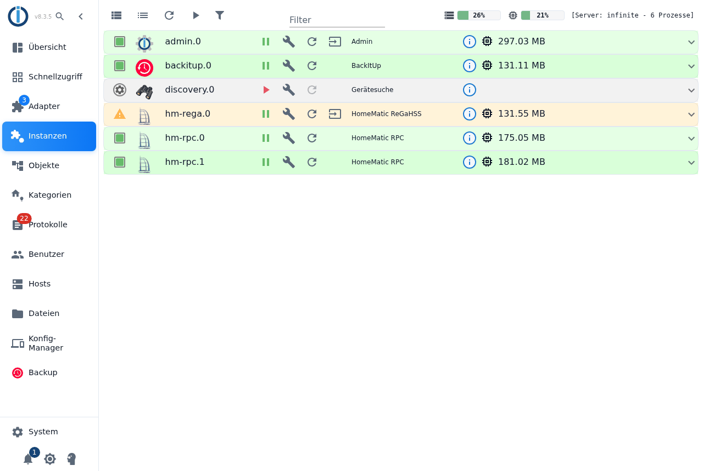

**hm-rpc aktualisieren.** openccu-lite braucht hm-rpc 4.3.0 oder neuer (im Labor 4.3.2). Im November 2026 steht diese
Version nur im Beta-Repository:

1. Im ioBroker-Admin das Zahnrad unten links (**Basiseinstellungen**) → **Repositories**, beim Eintrag *beta* den Haken
   unter *Aktiv* setzen, die Warnung mit **OK** bestätigen, **Speichern und schließen**.

   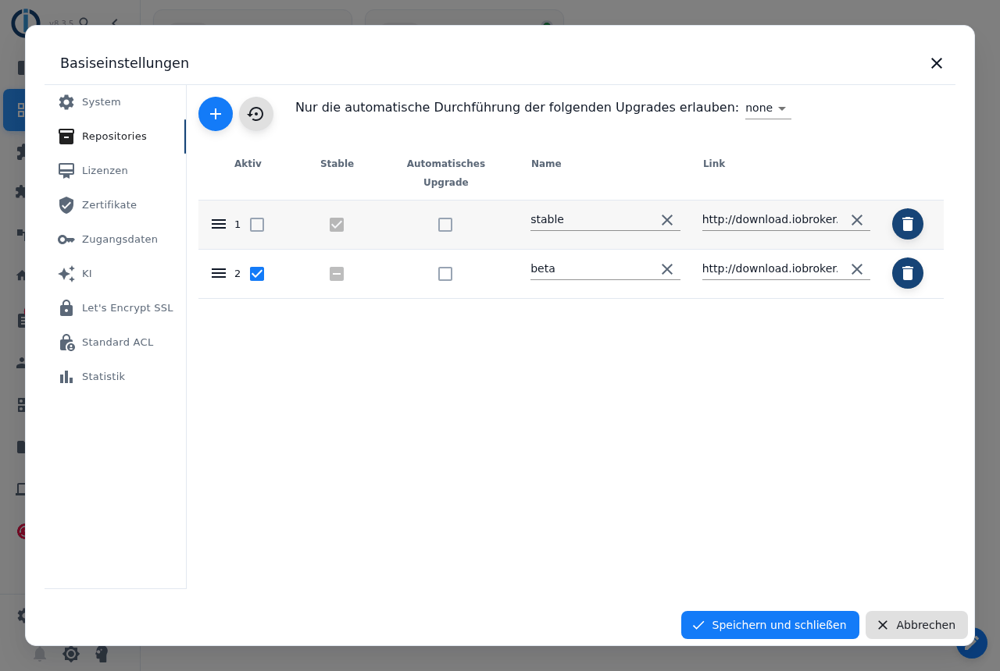

2. **Adapter**, nach *hm-r* filtern (im Labor zeigte die Liste die neue Version erst nach einem Neuladen der Seite).
   Auf der Karte *HomeMatic RPC* auf die neue Versionsnummer klicken und **Aktualisieren**.

   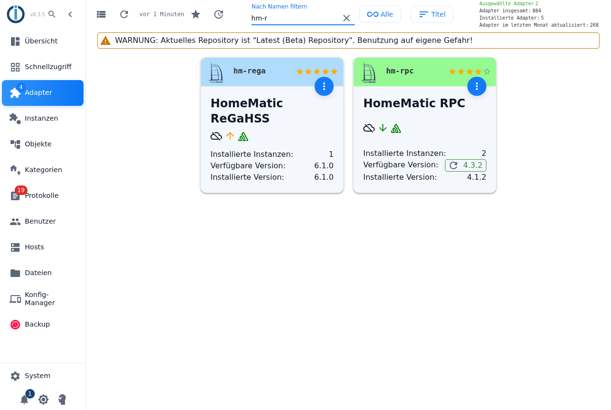

3. **Instanzen**: die Instanz von hm-rega anhalten (Pause-Symbol).

**Jede hm-rpc-Instanz umstellen** (die bestehende, keine neue, damit die Objekt-IDs bleiben):

1. Die Einstellungen der Instanz öffnen (Schraubenschlüssel). **Dämon:** *openccu-lite*. **HomeMatic Adresse** bleibt
   die Adresse des Systems.

   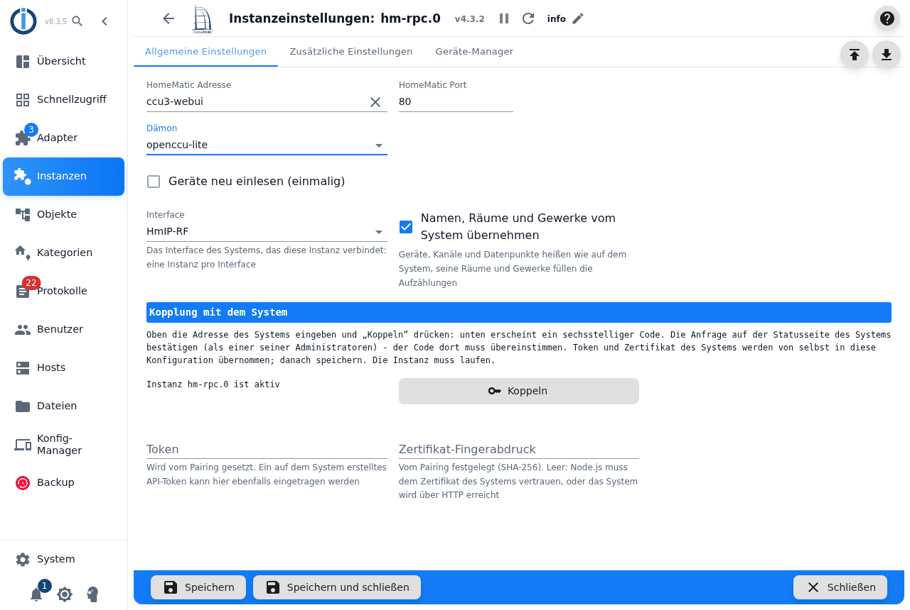

2. Reiter **Zusätzliche Einstellungen**: **HTTPS verwenden** ankreuzen (der Port wird 443).

   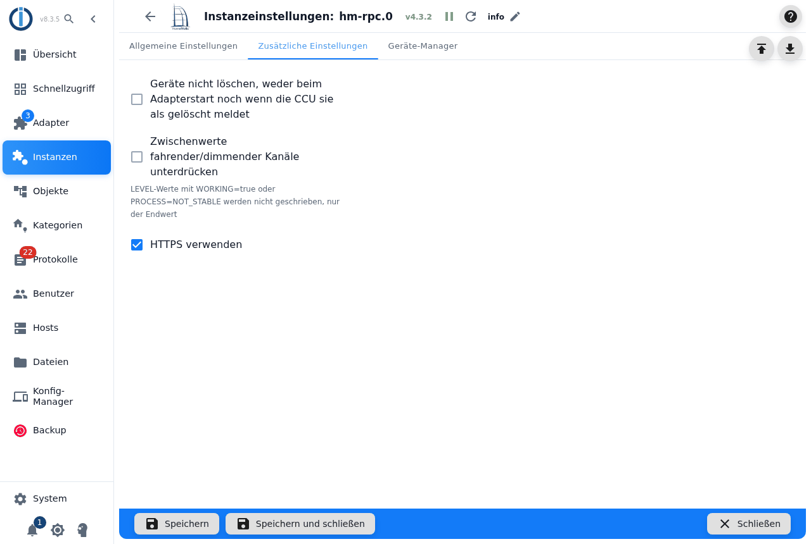

3. Zurück unter **Allgemeine Einstellungen**: **Interface** prüfen. Die Instanz für HmIP-RF stand richtig auf
   *HmIP-RF*; die Instanz für die virtuellen Geräte stand ebenfalls auf *HmIP-RF* und musste auf **VirtualDevices**
   gestellt werden.

   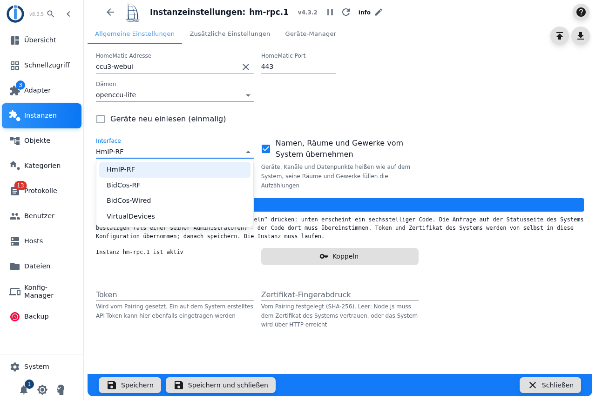

4. **Koppeln** drücken. Im Labor zeigte ioBroker dabei keinen Code an, nur einen drehenden Kreis; der Code steht auf
   der **Status-Seite des Systems**. Dort die Anfrage (*ioBroker.hm-rpc … bittet um Zugriff*) prüfen und
   **Genehmigen**.

   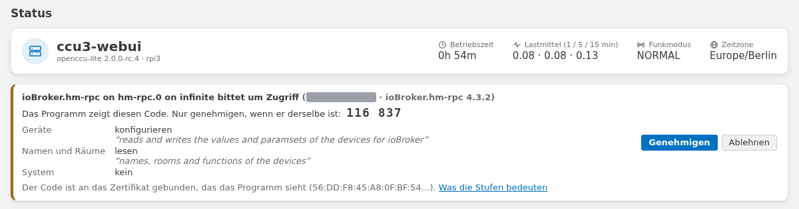

   **Genehmigen Sie zügig, innerhalb einer halben Minute.** Im Labor kam nach 10 und nach 30 Sekunden die Frage
   *Konfiguration speichern?*; nach 50 und nach 90 Sekunden blieb das Formular leer, obwohl das System die Kopplung
   angenommen hatte. Dann einfach noch einmal **Koppeln** drücken und den übrig gebliebenen Eintrag später entfernen
   (siehe unten).

5. *Konfiguration speichern?* mit **Speichern** beantworten. Token und Fingerabdruck stehen dann in der Instanz; sie
   startet neu, verbindet sich über das System (*lite-rpc client is connecting to https://… for the interface …*) und
   übernimmt die Namen, Räume und Gewerke des Systems.

   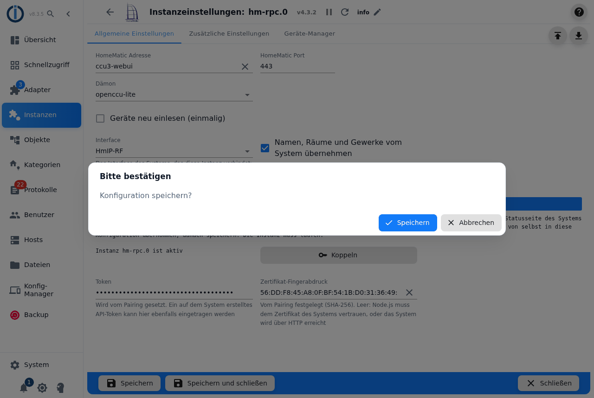

**Programme und Systemvariablen aus Logic.** Logic ist auf dem System eine eigene Schnittstelle namens *Logic*; ioBroker
erreicht sie über eine weitere hm-rpc-Instanz:

1. **Adapter** → Karte *HomeMatic RPC* → Menü **⋮** → **+** (Instanz hinzufügen).
2. In den Einstellungen der neuen Instanz **HomeMatic Adresse**, **Dämon** *openccu-lite* und **HTTPS verwenden**
   eintragen, **Speichern** und die Instanz starten (Symbol oben neben dem Namen); *Koppeln* geht erst, wenn sie läuft.
3. **Koppeln** und auf dem System genehmigen wie oben. Bevor Sie speichern: Mit dem Token fragt die Instanz das System
   nach seinen Schnittstellen, und unter **Interface** steht jetzt auch **Logic**. Logic wählen und speichern.

   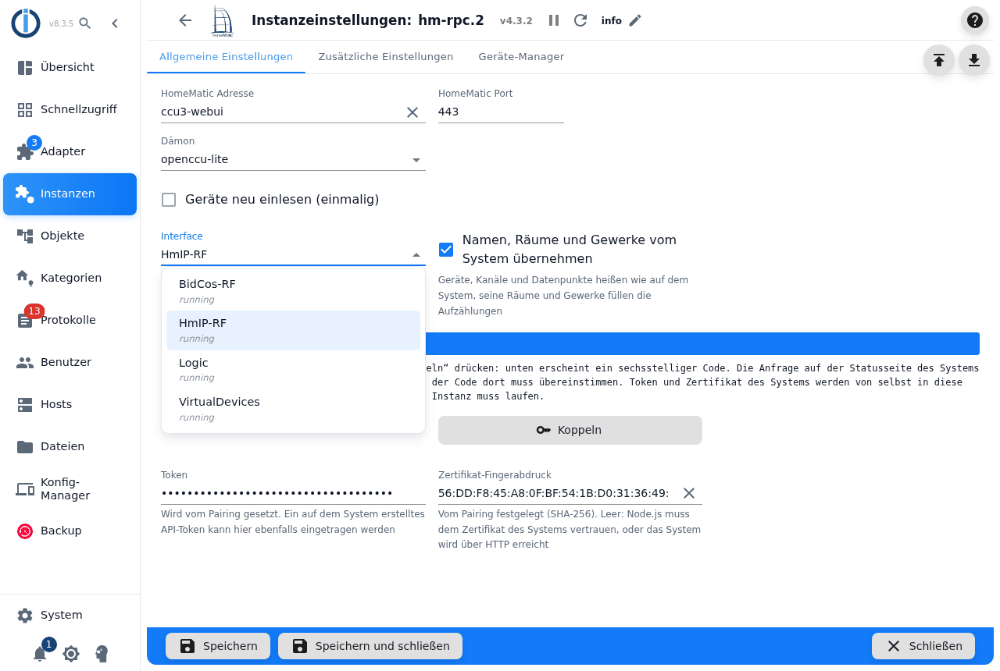

Die Instanz legt für jede Systemvariable ein Objekt `hm-rpc.<n>.var-<name>.1.VALUE` an (zum Beispiel
`var-urlaub.1.VALUE` für *Urlaub*) und für jedes Programm `hm-rpc.<n>.prg-<name>.1` mit `ACTIVE`, `RUN` und `LAST_RUN`.
Im Labor wurde *Urlaub* unter **Objekte** eingeschaltet; Logic führte daraufhin *Urlaub: Heizung absenken* aus. Umgekehrt
kam eine Änderung in Logic sofort im ioBroker an.

**hm-rega entfernen.** **Instanzen** → Zeile von hm-rega aufklappen → Papierkorb → **Adapter löschen**. Seine Objekte
(die alten Systemvariablen und Programme unter `hm-rega.0`) verschwinden damit; Scripts, die sie benutzten, zeigen Sie
vorher auf die neuen Objekte der Logic-Instanz um.

**Übrig gebliebene Kopplungen entfernen.** Jede Kopplung ist auf dem System ein API-Token (**System → Fernzugriff**,
Abschnitt *API-Tokens*). Ein Eintrag, dessen Spalte *Zuletzt benutzt* leer bleibt, stammt von einer Kopplung, die
ioBroker nicht gespeichert hat: **Widerrufen**.

### Home Assistant mit Homematic(IP) Local

Die direkte Verbindung von Homematic(IP) Local zur CCU braucht deren Logikschicht, die es unter openccu-lite nicht gibt.
Home Assistant verbindet sich stattdessen über das Addon **OpenCCU-Loom** auf dem System. Im Labor: Home Assistant
2026.11.3 mit Homematic(IP) Local **2.12.4b9** (eine Vorabversion; in HACS heißt das, Vorabversionen anzeigen zu lassen;
im Labor wurde das Archiv der Version von GitHub nach `custom_components` kopiert). Diese Anleitung legt einen neuen
Eintrag der Integration an; was beim Umstellen eines bestehenden Eintrags zu beachten ist, steht in
[Externe Clients nach dem Wechsel](switching.de.md#externe-clients-nach-dem-wechsel).

**OpenCCU-Loom auf dem System installieren:**

1. **Zusatzsoftware → Addons verwalten**, nach *Loom* filtern, auf der Karte **OpenCCU-Loom** auf **Installieren**
   klicken und die Frage bestätigen (eine Vorabversion).

   

2. Nach etwa einer Minute steht oben *openccu-loom: fertig* und auf der Karte *Läuft*. Es braucht keine weitere
   Einstellung: Loom richtet das System beim ersten Start selbst ein und sieht auch die Schnittstelle *Logic*.

   

**Die Integration in Home Assistant einrichten:**

1. **Einstellungen → Geräte & Dienste → Integration hinzufügen** → *Homematic(IP) Local for OpenCCU*. Die Integration
   fragt nach dem **Backend**: **Mit einem openccu-loom-Daemon verbinden (Beta)**.

   

   Diese Frage erscheint nur, wenn Home Assistant den Loom-Daemon im Netz gefunden hat. Im Labor fand ein Home
   Assistant in einem Docker-Container mit eigenem Netz ihn nicht und zeigte gleich das Formular für die direkte
   Verbindung; mit dem Netz des Rechners (`--network host`, wie bei Home Assistant OS) erschien die Frage.

2. Unter **Daemon auswählen** das System wählen, **OK**. Auf der nächsten Seite das Feld *openccu-lite-Box-Token* leer
   lassen und **OK** klicken.

   

3. Home Assistant zeigt einen **Kopplungscode**. Auf der **Status-Seite des Systems** steht dieselbe Anfrage
   (*homematicip_local … bittet um Zugriff*); den Code vergleichen und **Genehmigen**.

   

   

4. Home Assistant zeigt die gefundenen Geräte zum *Benennen und zuordnen*; **Fertigstellen**.

Im Labor kamen 21 Geräte: die Heizungsgruppen als Thermostate (in den Bereichen *Wohnzimmer* und *Gästezimmer*, aus den
Räumen des Systems) und **die Programme und Systemvariablen aus Logic** als eigene Geräte, zum Beispiel
`switch.urlaub_value` für *Urlaub*, `select.hausmodus_value` für *Hausmodus* und `switch.<programm>_active` für jedes
Programm.

Zum Ausprobieren wurde *Urlaub Value* in Home Assistant eingeschaltet; Logic führte daraufhin *Urlaub: Heizung absenken*
aus.

**Gut zu wissen:** Eine Heizungsgruppe ohne Mitglieder (wie die virtuellen Gruppen im Labor) meldet eine geänderte
Solltemperatur nicht an die Programme zurück; Home Assistant, ioBroker und Node-RED zeigen dann den alten Wert, bis
sie ihn neu lesen. Das ist auf einer OpenCCU genauso.

### Node-RED auf einem anderen Rechner (node-red-contrib-ccu)

Ein Node-RED anderswo im Netz spricht mit openccu-lite über die Schnittstelle des Systems und braucht dafür einen
Zugang, den Sie mit einer **Kopplung** bekommen. Bis dahin arbeitet eine bestehende Verbindung über das klassische RPC
weiter, solange es eingeschaltet ist (Abschnitt 3); Systemvariablen und Programme erreicht sie so nicht.

Im Labor: Node-RED 5.0.10 in einem Docker-Container mit **node-red-contrib-ccu 4.14.1**. Für Systemvariablen und
Programme aus Logic braucht es 4.14.0 oder neuer; eine ältere Version unter **Palette verwalten** aktualisieren und
Node-RED neu starten.

1. Die Verbindung öffnen: einen ccu-Knoten doppelt anklicken und den Stift neben *CCU* wählen (oder unter *Globale
   Konfigurations-Nodes*). **CCU address** bleibt der Name oder die Adresse des Systems.
2. **TLS/SSL** ankreuzen. Ohne den Haken koppelte Node-RED im Labor über unverschlüsseltes HTTP; mit ihm über HTTPS, und
   das Zertifikat des Systems wird dabei festgelegt.
3. Weiter unten auf **Pair with the system** klicken. Node-RED zeigt einen sechsstelligen Code (*Code … - approve it on
   the Status page of the system*).

   

4. Auf der **Status-Seite des Systems** steht die Anfrage *node-red-contrib-ccu … bittet um Zugriff* mit demselben Code.
   Vergleichen und **Genehmigen**. Node-RED bittet um die Stufe *verwalten*, weil der Knoten *rpc* jede Methode der
   Schnittstellen aufrufen darf.

   

5. Node-RED trägt Token und Zertifikat ein (*Paired as …, the certificate of the system pinned. Deploy to use it.*).
   **Aktualisieren** und dann **Übernahme (deploy)** klicken.

   

Nach dem Deploy verbindet sich Node-RED über das System mit allen Schnittstellen, auch mit *Logic* (im Log von Node-RED:
*lite-rpc connected: BidCos-RF, HmIP-RF, VirtualDevices, Logic*). Die Knoten *sysvar* und *program* arbeiten wie oben
unter RedMatic beschrieben: Im Labor lasen *Urlaub* und *Letzte Meldung* ihre Werte aus Logic, *Urlaub an* setzte die
Variable, und *Nachtmodus starten* startete das Programm (in Logic mit dem Auslöser *von außen*).

Eine Kopplung, die nicht benutzt wird (etwa die erste, wenn Sie ohne *TLS/SSL* gekoppelt und es dann noch einmal
versucht haben), widerrufen Sie unter **System → Fernzugriff** wie bei ioBroker beschrieben.

## 7. Zurück zur CCU3 oder zu OpenCCU

Der Weg zurück ist die Kopie des ganzen Systems aus Schritt 1.5 oder das Backup aus Schritt 1.4; die Einzelheiten
stehen in [openccu-lite → OpenCCU / CCU3](switching.de.md#openccu-lite--openccu--ccu3).
